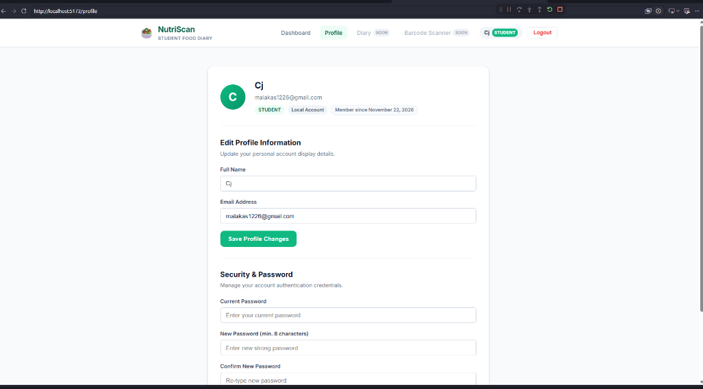
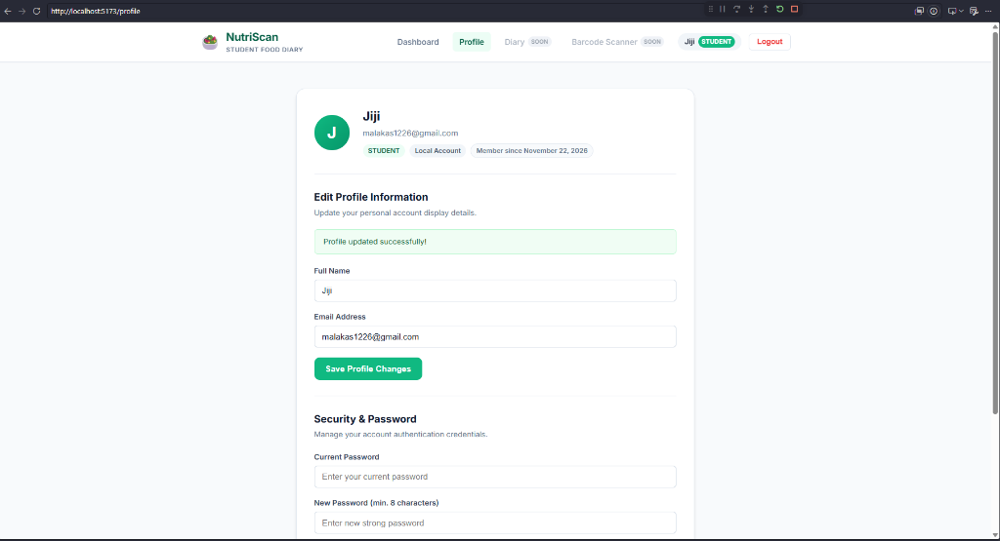
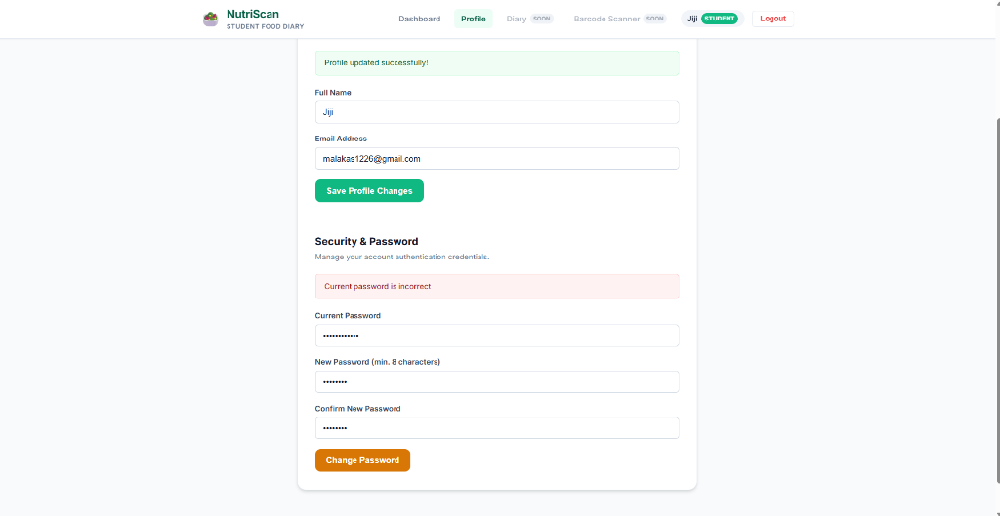
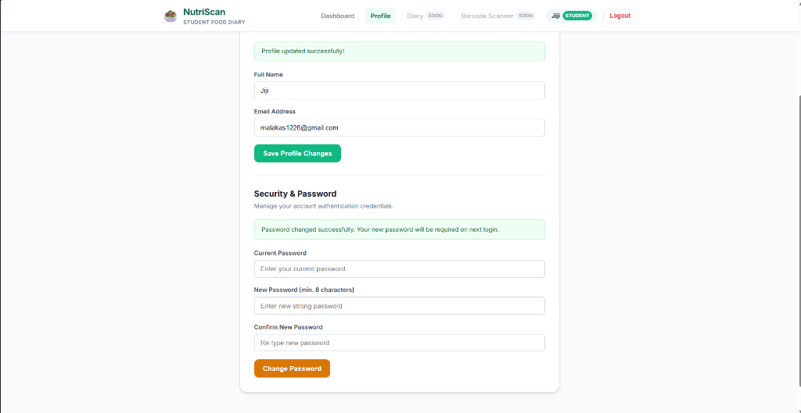
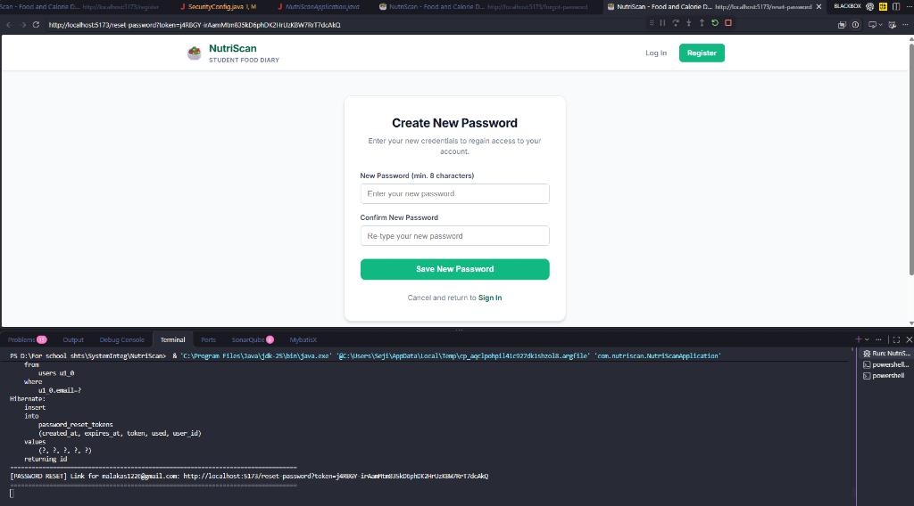
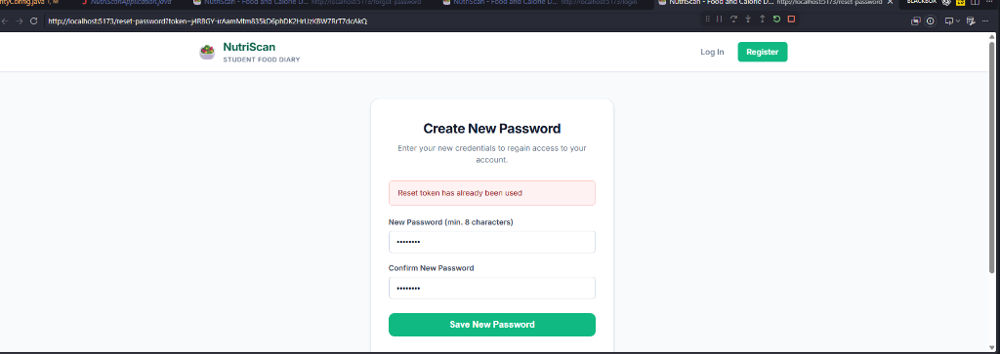

# IT342 – Systems Integration and Architecture 1
## Project Development 2
### Implementation / Completion Report

---

### Project Information

| Field | Details |
| :--- | :--- |
| **System Name** | NutriScan: Barcode-Based Food and Calorie Diary |
| **Student Name** | Pena, Christian Jay S. |
| **Section** | G01 |
| **Increment** | Project Development 2 – User Profile Management, Reset Password (Forgot Password), and Change Password |
| **GitHub Repository** | [https://github.com/JiiiJiii26/NutriScan-SystemInteg](https://github.com/JiiiJiii26/NutriScan-SystemInteg) |
| **Date Submitted** | 11/22/2026 |

---

### 1. Project Overview

NutriScan is a web-based dietary management application tailored for Filipino college students to monitor their daily caloric and nutritional intake from packaged grocery foods (e.g., instant noodles, canned goods, and student snacks). The system integrates barcode identification, nutritional diary logging, and user accounts to assist students in tracking their diet on a student budget.

**Core feature for this increment:** User Profile Management & Account Security Lifecycle (Profile Editing, Authenticated Password Change, and Token-Based Password Reset).

**Justification:**  
Self-service profile and credential lifecycle management is critical for student data integrity and application security. It ensures students can manage their personal profiles, maintain account security through password rotations, and recover account access independently without requiring manual database administrative intervention.

---

### 2. Features Implemented in This Increment

#### 2.1 Standard Features (from Project Development 1)

| Feature | Status | Notes |
| :--- | :--- | :--- |
| **Account Registration** | Complete | Local student registration with BCrypt (strength 10) password hashing; Google OAuth client configured (Not tested yet). |
| **Login / Logout** | Complete | Session-based authentication via `JSESSIONID` cookies; clean logout with HTTP session invalidation. |
| **Role-Based User Dashboard** | Complete | Protected `/dashboard` route enforcing `ROLE_STUDENT` credentials. |
| **User Profile (view and edit)** | Complete | `GET /api/profile` to retrieve member details and `PUT /api/profile` to update name/email with instantaneous Navbar greeting updates. |

---

#### 2.2 Core Feature: User Profile and Security Lifecycle

**Description:**  
Provides students with full self-service control over their identity and credentials. Local account students can modify their full name, update their registered email, and change their active password by verifying their existing credentials. Students who forget their password can initiate an unauthenticated recovery request, which generates a cryptographically secure, time-limited (15-minute) reset token to safely set a new password.

##### User Roles and Access

| Role | What this role can do in the feature |
| :--- | :--- |
| **STUDENT (Local Account)** | View profile details; edit full name and email; change password using current password; request password reset link and set new password using single-use token. |
| **STUDENT (Google OAuth)** | View profile and creation date; update display full name; email and password changes are securely locked with clear Google SSO guidance. *(Not tested yet)* |
| **Unauthenticated Guest** | Cannot view or modify profile endpoints (enforced `401 Unauthorized`); can request password reset token via `/api/auth/forgot-password` and complete reset via `/api/auth/reset-password`. |

##### User Flow
1. **Profile Editing:**
   - Student logs in and navigates to the **Profile** page via the navigation bar (`/profile`).
   - Student reviews current profile details (Full Name, Email, Role, Provider, and Account Registration Date).
   - Student modifies their Full Name or Email and clicks **"Save Profile Changes"**.
   - Input is validated server-side, the database is updated, and the Navbar greeting immediately reflects the new name.
2. **Password Change (Authenticated):**
   - Under the "Security & Password" section on `/profile`, student inputs their Current Password, New Password (min. 8 characters), and Confirm New Password.
   - Upon clicking **"Change Password"**, the backend validates current password against the stored BCrypt hash, hashes the new password, and saves it.
   - The old password is immediately invalidated for future logins while current session remains active.
3. **Forgot & Reset Password (Unauthenticated):**
   - On `/login`, student clicks **"Forgot Password?"** and enters their registered email at `/forgot-password`.
   - Backend validates input and returns a generic success notification (preventing email enumeration attacks).
   - For local accounts, a secure token valid for 15 minutes is logged to the backend console: `http://localhost:5173/reset-password?token=<TOKEN>`.
   - Student clicks the link, enters and confirms a new password at `/reset-password`.
   - The token is verified, the new password is saved via BCrypt, the token is marked as `used = true`, and the student logs in with their new credentials.

##### CRUD Operations

| Operation | Implemented? (Yes/No) | Where in the UI | Who can do it |
| :--- | :--- | :--- | :--- |
| **Create** | Yes | `/forgot-password` (Creates reset token in `password_reset_tokens`) | Any user / Guest |
| **Read** | Yes | `/profile` (Reads user details and creation date) | Authenticated `STUDENT` |
| **Update** | Yes | `/profile` (Updates `full_name`, `email`), `/profile` & `/reset-password` (Updates `password_hash`) | Authenticated `STUDENT` / Token Bearer |
| **Delete / Invalidate** | Yes | Token invalidation upon use (`used = true`) or session logout | Authenticated `STUDENT` / System |

##### Database Models

| Model / Table | Key Fields | Relationships (ForeignKey / ManyToMany) |
| :--- | :--- | :--- |
| **`users`** | `id`, `full_name`, `email`, `password_hash`, `role`, `provider`, `created_at` | Referenced by `password_reset_tokens.user_id` (One-to-Many) |
| **`password_reset_tokens`** | `id`, `user_id`, `token`, `expires_at`, `used`, `created_at` | `user_id` &rarr; `users.id` (Foreign Key, `ON DELETE CASCADE`) |

##### Key Files

| Layer | File path(s) |
| :--- | :--- |
| **Models / Entities** | `backend/src/main/java/com/nutriscan/model/User.java` `backend/src/main/java/com/nutriscan/model/PasswordResetToken.java` |
| **Repositories** | `backend/src/main/java/com/nutriscan/repository/UserRepository.java` `backend/src/main/java/com/nutriscan/repository/PasswordResetTokenRepository.java` |
| **Services** | `backend/src/main/java/com/nutriscan/service/UserService.java` `backend/src/main/java/com/nutriscan/service/PasswordResetService.java` |
| **Controllers / APIs** | `backend/src/main/java/com/nutriscan/controller/AuthController.java` `backend/src/main/java/com/nutriscan/controller/ProfileController.java` |
| **DTOs** | `backend/src/main/java/com/nutriscan/dto/UpdateProfileRequest.java` `backend/src/main/java/com/nutriscan/dto/ChangePasswordRequest.java` `backend/src/main/java/com/nutriscan/dto/ForgotPasswordRequest.java` `backend/src/main/java/com/nutriscan/dto/ResetPasswordRequest.java` `backend/src/main/java/com/nutriscan/dto/UserResponse.java` |
| **Security Config** | `backend/src/main/java/com/nutriscan/config/SecurityConfig.java` `backend/src/main/java/com/nutriscan/config/CorsConfig.java` |
| **Frontend Pages & Routes** | `frontend/src/pages/Profile.jsx` `frontend/src/pages/ForgotPassword.jsx` `frontend/src/pages/ResetPassword.jsx` `frontend/src/App.jsx` `frontend/src/components/Navbar.jsx` `frontend/src/pages/Login.jsx` |

##### Validation and Business Rules

| Rule | How it is enforced |
| :--- | :--- |
| **Full Name Length** | Jakarta Validation `@Size(min = 2, max = 100)` and `@NotBlank` on `UpdateProfileRequest`. |
| **Email Format & Uniqueness** | `@Email` validation on requests; database unique constraint checking in `UserService.updateProfile()`. |
| **Google SSO Protection** | If `provider === 'GOOGLE'`, email update is blocked with HTTP 400; password change form is replaced with informational banner. |
| **Password Complexity & Match** | New passwords require minimum 8 characters; `newPassword.equals(confirmPassword)` checked before hashing. |
| **Current Password Verification** | `passwordEncoder.matches(currentPassword, user.getPasswordHash())` must return `true`. New password cannot equal current password. |
| **Token Expiry & Single-Use** | Tokens expire after 15 minutes (`expires_at < now()`); tokens with `used == true` are rejected with HTTP 400. |
| **Anti-Enumeration Protection** | `POST /api/auth/forgot-password` returns identical 200 OK message regardless of whether email exists or is Google-managed. |
| **ID Injection Prevention** | `/api/profile` does not take an `id` parameter; user identity is pulled exclusively from the authenticated session `SecurityContext`. |

##### Branches and Pull Requests

| Branch | Merged Into | Pull Request Link | What it contains |
| :--- | :--- | :--- | :--- |
| `feature/increment-2-profile-password` | `develop` | *[https://github.com/JiiiJiii26/NutriScan-SystemInteg/pull/2](https://github.com/JiiiJiii26/NutriScan-SystemInteg)* | Implementation of Profile editing, Change Password, and Password Reset flow. |
| `develop` | `main` | *[https://github.com/JiiiJiii26/NutriScan-SystemInteg/pull/3](https://github.com/JiiiJiii26/NutriScan-SystemInteg)* | Increment 2 release merge. |

---

##### Screenshots & Captions

###### Screenshot 1: Profile View

*Caption: Profile page (`/profile`) displaying student account information for "Cj" (`malakas1226@gmail.com`), including the role badge (`STUDENT`), account provider badge (`Local Account`), and registration timestamp (`Member since November 22, 2026`).*

---

###### Screenshot 2: Profile Update Success

*Caption: Successful profile update (`PUT /api/profile`) changing the student's full name from "Cj" to "Jiji". Displays the green "Profile updated successfully!" confirmation alert, and the navigation bar greeting in the top-right updates immediately to "Jiji STUDENT" via AuthContext without requiring a page refresh.*

---

###### Screenshot 3: Validation Error on Change Password

*Caption: Server-side password validation failure (`POST /api/auth/change-password`). Displays the error alert "Current password is incorrect" when the student submits an invalid current password.*

---

###### Screenshot 4: Password Change Success

*Caption: Successful password change notification: "Password changed successfully. Your new password will be required on next login." Form input fields are cleared immediately for credential safety.*

---

###### Screenshot 5: Terminal Console Link & Reset Password Form

*Caption: Dual-view demonstration of the password reset flow. The bottom terminal shows the Spring Boot backend logging `[PASSWORD RESET] Link for malakas1226@gmail.com: http://localhost:5173/reset-password?token=...` after inserting the token record into `password_reset_tokens`. The browser window above shows the student accessing the link to set a new password.*

---

###### Screenshot 6: Single-Use Token Enforcement

*Caption: Single-use token security check. When attempting to reuse an already-consumed reset token, the application rejects the request and displays the alert: "Reset token has already been used".*

---

### 3. Remaining Tasks

| No. | Task | Description | Priority | Target Increment |
| :--- | :--- | :--- | :--- | :--- |
| 1 | **Barcode Scanner Integration** | Implement client-side camera/barcode scanner (QuaggaJS/html5-qrcode) to scan Philippine grocery barcodes. | High | Project Development 3 |
| 2 | **Food & Calorie Diary Logging** | Enable students to log consumed items, calculate total calories, and track macronutrient totals. | High | Project Development 3 |
| 3 | **Open Food Facts API Integration** | External REST API integration to fetch ingredient lists and nutritional facts for Philippine snacks and canned items. | Medium | Project Development 3 |
| 4 | **Google OAuth 2.0 Live Credentials** | Configure and test live production Google Cloud Client ID & Secret for SSO. | Medium | Project Development 3 |
| 5 | **SMTP Mail Service Integration** | Replace console log reset links with Spring Boot JavaMailSender (SendGrid / Gmail SMTP). | Low | Project Development 4 |

---

### 4. Outstanding Issues

| Issue ID | Description | Steps to Reproduce | Severity | Status / Workaround |
| :--- | :--- | :--- | :--- | :--- |
| *N/A* | No known issues. All 19 backend test suites pass with 0 errors and frontend builds with 0 warnings. | 1. `mvn test` 2. `npm run build` | Minor / None | **Resolved & Tested** |

---

### 5. Test Accounts

| Role | Username / Email | Password |
| :--- | :--- | :--- |
| **Student (Local Primary)** | `malakas1226@gmail.com` | `Jiiiiii123` |
| **Student (Local Secondary)** | `juan.pedro@university.edu.ph` | `BrandNewPassword789!` |
| **Student (Google OAuth)** | *(Google Account)* | *Not tested yet* |

---

### 6. Declaration

I declare that the work described in this report is my own, that it is accurately reflected in my GitHub repository, and that all remaining tasks and known issues are disclosed above.

**Name:** Christian Jay S. Pena  
**Date:** 11/22/2026
